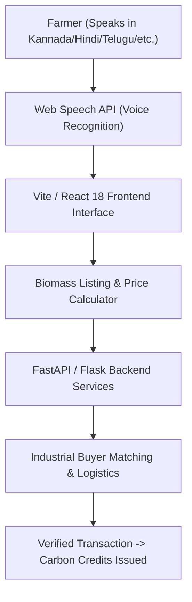

# 🌾 Agri-Bridge (AgroSmart)

<p align="center">
  
</p>

<p align="center">
  A mobile-first peer-to-peer (P2P) agricultural biomass marketplace connecting smallholder farmers directly with industrial buyers to trade crop residue, eliminate seasonal stubble burning, and automate farmer profits and CO₂ offsets with multilingual voice navigation.
</p>

<p align="center">
  <a href="https://github.com/prakruthidevanga/Agri-Bridge">
    
  </a>
</p>

<p align="center">
  
  
  
  
  
</p>

---

## 📌 Table of Contents

- [📖 Project Overview](#-project-overview)
- [🎯 Objectives](#-objectives)
- [✨ Key Features](#-key-features)
- [🗣️ Multilingual Voice Navigation](#️-multilingual-voice-navigation)
- [🏗️ System Architecture & Workflow](#️-system-architecture--workflow)
- [🛠️ Technology Stack](#️-technology-stack)
- [📁 Repository Structure](#-repository-structure)
- [⚙️ Installation and Setup](#️-installation-and-setup)
- [🔮 Future Enhancements](#-future-enhancements)
- [🤝 Contributing](#-contributing)
- [👩‍💻 Author & Accreditations](#-author--accreditations)

---

## 📖 Project Overview

Across rural India, seasonal **crop residue burning (stubble burning)** creates severe environmental hazards, releasing millions of tons of particulate matter ($PM_{2.5}$) and greenhouse gases into the atmosphere while degrading topsoil fertility. Smallholder farmers frequently burn residue because they lack access to industrial buyers, transparent logistics, and digital tools tailored to non-English speakers.

**Agri-Bridge (AgroSmart)** resolves this challenge by building an accessible circular economy platform. Farmers list agricultural biomass (paddy straw, wheat stubble, sugarcane bagasse, cotton stalks) and connect directly with biofuel, paper, and packaging enterprises. The platform automatically calculates farmer earnings, projects carbon offsets, and integrates voice navigation across **6 regional languages** to ensure zero digital barriers.

🌱 **Core Mission:** Convert agricultural waste into a reliable revenue stream while eliminating stubble burning through accessible voice AI.

---

## 🎯 Objectives

- 🌾 **Eliminate Stubble Burning:** Divert agricultural crop residue from open field fires into industrial supply chains.
- 💰 **Supplement Rural Incomes:** Create direct-to-industry monetization channels for farm waste without intermediary exploitation.
- 🗣️ **Overcome Language Barriers:** Provide full speech-to-text voice navigation and conversational assistance in regional Indian dialects.
- 💨 **Quantify Carbon Offsets:** Dynamically compute metric tons of $CO_2$ emissions avoided per biomass transaction.
- 🏆 **Incentivize Sustainable Farming:** Reward farmers with redeemable carbon credit tokens.

---

## ✨ Key Features

### 🛒 1. Direct P2P Biomass Marketplace
Farmers create structured listings detailing residue type, quantity (in quintals or tons), moisture content, and pickup location, allowing verified industrial procurement teams to place direct bids.

### 🗣️ 2. Regional Voice Assistant (6 Languages)
Integrated **Web Speech API** enables farmers to speak to the app in:
- **Kannada** (ಕನ್ನಡ)
- **Hindi** (हिन्दी)
- **Telugu** (తెలుగు)
- **Tamil** (தமிழ்)
- **Marathi** (मराठी)
- **English**

### 📉 3. Automated Revenue & CO₂ Offset Calculator
Each listing dynamically calculates estimated fair market price and environmental impact:
$$\text{CO}_2\text{ Offset (kg)} = \text{Residue Quantity (kg)} \times \text{Emission Factor}$$

### 🌿 4. AI Crop Disease Scanner
Interactive camera module enabling farmers to take leaf photos and retrieve immediate diagnosis guidelines and recommended treatments.

---

## 🏗️ System Architecture & Workflow



---

## 🛠️ Technology Stack

<p align="center">
  
</p>

| Component | Technology | Implementation Details |
| :--- | :--- | :--- |
| **Frontend Framework** | React 18 & Vite | Blazing fast client rendering, modular component trees, state management |
| **Styling & Design** | Tailwind CSS | Mobile-first responsive UI, high contrast color palette for outdoor readability |
| **Voice Interface** | Web Speech API | Client-side speech recognition (`webkitSpeechRecognition`) and text-to-speech synthesis |
| **Backend Services** | FastAPI / Python | High-performance asynchronous REST endpoints for marketplace matching |
| **Deployment** | Netlify / Vercel | Instant global edge delivery and continuous CI/CD deployments |

---

## 📁 Repository Structure

```text
Agri-Bridge/
├── backend/
│   ├── auth.py                  # JWT authentication and user session management
│   ├── database.py              # Database configuration and connection pool
│   ├── gemini_service.py        # GenAI agricultural advisory service
│   ├── main.py                  # FastAPI application entry point
│   ├── requirements.txt         # Python backend dependencies
│   └── .env.example             # Sanitized environment template
├── src/                         # React frontend source
│   ├── components/              # Marketplace cards, voice assistants, and scanners
│   ├── App.jsx                  # Main application orchestrator
│   └── index.css                # Tailwind styling rules
├── package.json                 # Frontend dependencies and build scripts
├── vite.config.js               # Vite bundler configuration
└── README.md                    # Project documentation
```

---

## ⚙️ Installation and Setup

### Prerequisites
- Node.js (v18 or higher)
- Python 3.9 or higher
- Git

### Step 1: Clone Repository
```bash
git clone https://github.com/prakruthidevanga/Agri-Bridge.git
cd Agri-Bridge
```

### Step 2: Set Up Backend
```bash
cd backend
python -m venv .venv
.\.venv\Scripts\Activate.ps1
pip install -r requirements.txt
python main.py
```

### Step 3: Set Up Frontend
Open a separate terminal:
```bash
npm install
npm run dev
```
*Open `http://localhost:5173` in your browser.*

---

## 🔮 Future Enhancements

- 🛰️ **Satellite Field Verification:** Integration with ISRO Bhuvan and Sentinel-2 APIs for automated stubble burning detection and verified burn-free certification.
- 🚛 **Decentralized Logistics:** Geolocation-based truck dispatching to optimize collective residue aggregation routes.
- 💳 **Micro-Financing:** Direct UPI payment integration with instant escrow settlement upon verified weigh-bridge delivery.

---

## 🤝 Contributing

We welcome contributions to expand regional language datasets and agricultural models!
1. Fork the Project
2. Create your Feature Branch (`git checkout -b feature/AddTamilVoiceDialect`)
3. Commit your Changes (`git commit -m 'feat: add Tamil voice support'`)
4. Push to the Branch (`git push origin feature/AddTamilVoiceDialect`)
5. Open a Pull Request

---

## 👩‍💻 Author & Accreditations

**Prakruthi B R**  
*BCA Student specializing in Artificial Intelligence & Machine Learning*  
*Alliance University, Bengaluru (CGPA: 9.60)*  
*GeeksforGeeks Campus Mantri (2026)*

- 💻 **GitHub:** [@prakruthidevanga](https://github.com/prakruthidevanga)
- 🔗 **LinkedIn:** [Prakruthi BR](https://linkedin.com/in/prakruthi-br)
- 🌐 **Portfolio:** [prakruthidevanga.github.io](https://prakruthidevanga.github.io/)
- 📬 **Email:** [prakruthibr2006@gmail.com](mailto:prakruthibr2006@gmail.com)

---

<p align="center">
  <b>🌾 Bridging farmers, industries, and sustainable technology.</b>
</p>

<p align="center">
  
</p>
